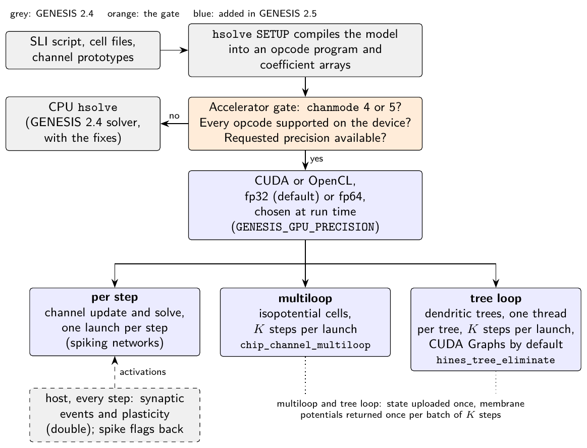
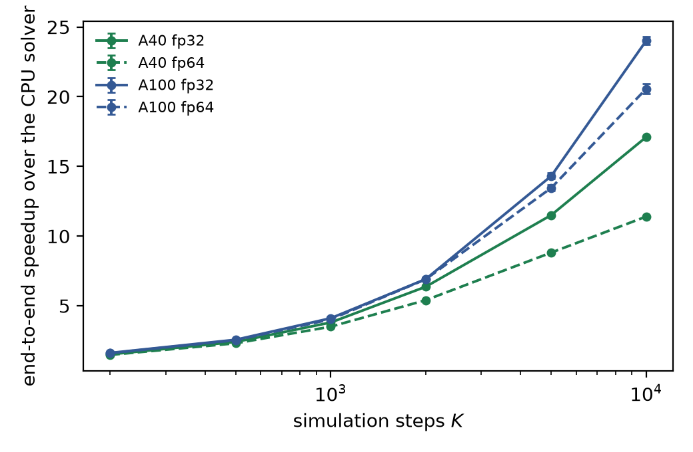
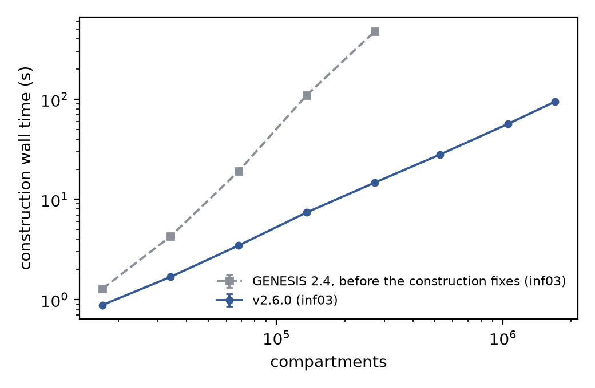
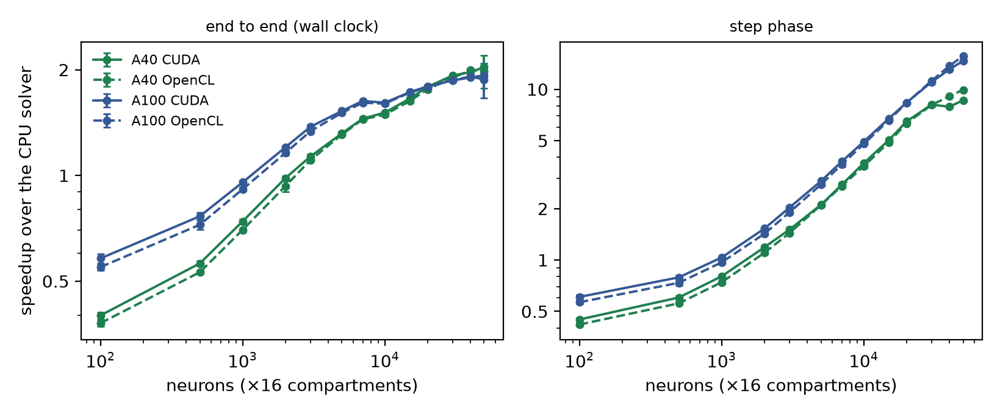

# GENESIS 2.5

GENESIS 2.5 runs existing GENESIS models on a GPU. It adds CUDA and OpenCL
backends to `hsolve`, the compartmental solver of GENESIS 2.4, selected at run
time, in single or double precision, with no change to model scripts, cell files
or channel prototypes. A model the GPU cannot compute is reported and left to the
CPU solver. Without a GPU backend it behaves as GENESIS 2.4, with two defects of
the Hines solver and the quadratic cost of building large models fixed.

- **Release:** [v2.6.2](https://github.com/WarsawIQ/genesis-2.5/releases/tag/v2.6.2),
  with Linux binaries; archived at [10.5281/zenodo.23451767](https://doi.org/10.5281/zenodo.23451767)
  (all versions: [10.5281/zenodo.21716630](https://doi.org/10.5281/zenodo.21716630)).
- **Paper:** under review at SoftwareX
  ([revised manuscript](paper/submission-revision/manuscript_softwarex_revision.pdf)).
  Its numbers were measured on [v2.6.0](https://doi.org/10.5281/zenodo.23298087).
- **Upstream:** an independently maintained derivative of
  [genesis-sim/genesis-2.4](https://github.com/genesis-sim/genesis-2.4); the CPU
  fixes are offered there as [pull request #7](https://github.com/genesis-sim/genesis-2.4/pull/7).

<p align="center">
  
</p>

## Results

Measured on release v2.6.0 on the UMCS "Lunar" cluster (NVIDIA A40 and A100),
each GPU arm against one CPU core in the same solver mode. Every number below is
computed from the raw data in this repository
([reproducing them](#reproducing-the-paper)).

- **Populations of dendritic trees gain the most.** 160,000 compartments over
  10,000 steps run <!--claim:e2_max_e2e_a100-->24.0<!--/claim-->× faster end to end on an A100 and
  <!--claim:e2_max_e2e_a40-->17.1<!--/claim-->× on an A40. The gain grows with run length as the setup
  cost is amortised. Double precision takes <!--claim:e2_fp64_cost_a100-->1.17<!--/claim-->× the fp32 time on
  the A100 and <!--claim:e2_fp64_cost_a40-->1.50<!--/claim-->× on the A40.
- **Isopotential cells without synapses:** <!--claim:e3_t1_cuda_a100_n50000-->20.60<!--/claim-->× on an A100 and
  <!--claim:e3_t1_cuda_a40_n50000-->19.28<!--/claim-->× on an A40 at 50,000 cells.
- **Spiking networks with zero axonal delay run slower on the GPU**
  (<!--claim:e1_g_gpu32_1s_rel-->1.14<!--/claim-->× the CPU's time), because the host delivers spikes every step.
- **Precision.** In fp64 the GPU reproduces the CPU solver to ten significant
  figures; in fp32 it agrees to within <!--claim:fp32_single_ap_v-->2e-07<!--/claim--> V over one action potential.
- **On one CPU core**, NEURON 9.0.2 takes <!--claim:e1_nrn_cpu_rel-->2.90<!--/claim-->× and CoreNEURON
  <!--claim:e1_cn_cpu_rel-->2.21<!--/claim-->× as long as GENESIS on the Vogels–Abbott network.
- **Model construction.** Before the fixes, 272,000 compartments took
  <!--claim:e3c_before_272k_min-->8<!--/claim--> minutes to build, and 1.7 million would have taken about
  <!--claim:e3c_before_1700k_h-->7<!--/claim--> hours. They now build in <!--claim:e3c_construction_1700k_s-->94.9<!--/claim--> s, and construction
  grows as compartments<sup><!--claim:e3c_construction_exponent-->1.02<!--/claim--></sup>.

<p align="center">
  
  
</p>
<p align="center">
  
</p>

**When to use the GPU** (Table 4 of the paper):

| Workload | GPU? | Why |
|---|---|---|
| One detailed morphology, or fewer than about <!--claim:regime_trees_min_n-->3000<!--/claim--> trees | No | too few trees to fill the device; the GPU is slower |
| Population of dendritic trees | Yes, from about <!--claim:regime_trees_min_n-->3000<!--/claim--> cells | many trees fill the device |
| Isopotential cells without synapses | Yes | <!--claim:regime_single_max-->21<!--/claim-->× at 50,000 cells |
| Spiking network, zero axonal delay | No: <!--claim:e1_g_gpu32_1s_rel-->1.14<!--/claim-->× slower | spikes are exchanged every step |
| Long runs | Gain grows with length | the fixed setup cost is amortised |

## Install

**Binaries.** The v2.6.2 release carries `genesis-v2.6.2-linux-x86_64.tar.gz` with
`nxgenesis` (CUDA 12), `nxgenesis_ocl` (OpenCL 1.2) and `nxgenesis_nocl` (CPU
only), built on AlmaLinux 8.10 (glibc 2.28); its `README.txt` lists the libraries
each one needs.

**From source** (Linux x86_64, GCC, GNU make, flex, bison, ncurses):

```sh
git clone https://github.com/WarsawIQ/genesis-2.5.git
cd genesis-2.5/genesis/src
make clean && make && make install                     # CPU only, as GENESIS 2.4
make USE_CUDA=1 CUDA_HOME=/usr/local/cuda nxgenesis    # or with CUDA 12.x
make USE_OPENCL=1 nxgenesis                            # or with OpenCL 1.2+
```

PGENESIS, the `libfl` stub many systems need, the CUDA link line and the build
failures we have seen are in [docs/BUILDING.md](docs/BUILDING.md).

## Use

A model needs no change as long as its solver uses `chanmode` 4 or 5, modes
GENESIS 2.4 already has:

```
create hsolve /net/solver
setfield /net/solver path "/net/##[][TYPE=compartment]" chanmode 4
call /net/solver SETUP
```

Started with `nxgenesis` (CUDA) or `nxgenesis_ocl` (OpenCL), it runs on the GPU.
The start-up lines name the backend, the precision and the dispatch path. Batching
and precision are chosen when the run starts:

| Variable | Effect |
|---|---|
| `GENESIS_GPU_PRECISION=fp64` | double precision in the same binary (default `fp32`); a device without it refuses with a message and the model runs on the CPU |
| `GENESIS_CUDA_MULTILOOP=<K>`, `GENESIS_OCL_MULTILOOP=<K>` | run K steps per dispatch for isopotential cells and dendritic trees, instead of one |
| `GENESIS_CUDA_GRAPH=0` or `1` | CUDA Graphs; by default on for the tree loop, where they save a few per cent, and off for the per-step path |
| `GENESIS_OCL_TREE_MAX_NCOMPTS=<N>` | the cap on the batched OpenCL tree dispatch (default <!--claim:ocl_igpu_tree_cap-->20,000<!--/claim--> compartments); `0` removes it |
| `GENESIS_OCL_DISPATCH_MS=<ms>` | from 2.6.1: on an integrated GPU, the length of each piece a long batch is split into (default 500); `0` never splits |

**With OpenCL on a dedicated GPU, set `GENESIS_OCL_TREE_MAX_NCOMPTS=0` for models
above <!--claim:ocl_igpu_tree_cap-->20,000<!--/claim--> compartments.** The default cap protects integrated GPUs
that also drive a display. Above it the batched tree solver declines the model and
runs it step by step, correctly but several times slower, and says so on stderr.

How the kernels work, including the dead ends, is in
[`genesis/src/hines/GPU_HINES_SOLVE_DESIGN.md`](genesis/src/hines/GPU_HINES_SOLVE_DESIGN.md).

## Known issues

Two past releases gave wrong results on the GPU, and every release from v2.5 to
v2.6.1 crashes on reading some cells. If you used one of them, read
[KNOWN_ISSUES.md](KNOWN_ISSUES.md):

- **v2.5 to v2.6.1**: `readcell` crashes on a cell whose compartments have
  coordinates, and re-creating an element made at start-up duplicates it (fixed in
  2.6.2; no computed number was affected).

- **v2.5**: models with synaptic channels, a `spike` element, GHK or
  concentration pools under `chanmode` 4 or 5 (fixed in 2.5.1).
- **v2.5.1 to v2.5.4**: spiking networks on CUDA fired a spurious spike in the
  first step; on both backends a second run after `RESET` started where the first
  ended, and `HGET`/`HPUT` used the host's stale copy (fixed in 2.6.0).

The same file lists the smaller issues, all fixed.

## Reproducing the paper

```sh
sh reproduce/run_all.sh --cpu-only --quick   # 2 min, no GPU
sh reproduce/run_all.sh --quick              # 14 min on an A100, NVIDIA GPU, CUDA 12.x
sh reproduce/run_all.sh                      # 70 min, the paper's full sizes
```

`run_all.sh` runs the stages that measured the paper
([`cluster_bringup/campaign/`](cluster_bringup/campaign/)) on your machine and
computes the paper's numbers from what they measured, with the same code that
computed the published values, and prints both with a verdict. The CPU-only path
also runs in a container (`docker build -t genesis25-cpu . && docker run --rm
genesis25-cpu`) and in [CI](.github/workflows/cpu-only.yml) on every push. What
each mode measures, how long it takes and how the verdicts work:
[reproduce/README.md](reproduce/README.md).

<details>
<summary>Where every number of the paper comes from, and what measuring it again needs</summary>

<!-- claims-table:begin -->
| Numbers | Where they appear | Script that measures them | Needs | Time |
|---:|---|---|---|---|
| 1 | Section 4 | none: taken from the cited literature (source in `reproduce/claims.csv`) | - | - |
| 2 | Section 2; Section 3 | `cluster_bringup/80_accel_regression.sh` | NVIDIA A40, any Linux machine | 1 min |
| 26 | Table 3 | `cluster_bringup/campaign/E1_cross_simulator.sh` | NVIDIA A100, NVIDIA GPU with Arbor built for CUDA, NVIDIA GPU with the NVHPC CoreNEURON build | 65 min |
| 4 | Fig. 3; Section 3; abstract | `cluster_bringup/campaign/E2_ksweep.sh` | NVIDIA A100, NVIDIA A40 | 60 min |
| 26 | Table 2; Table 4 | `cluster_bringup/campaign/E3_tables.sh` | NVIDIA A100, NVIDIA A40 | 60 min |
| 2 | Fig. 5; Section 4 | `cluster_bringup/campaign/E3c_cpu.sh` | any Linux machine | 45 min |
| 6 | Fig. 4; Section 3 | `cluster_bringup/campaign/E4_fp64_cost.sh` | NVIDIA A100, NVIDIA A40 | 25 min |
| 17 | Section 3 | `cluster_bringup/campaign/E5_long_run.sh` | NVIDIA A100 | 35 min |
| 10 | Section 3 | `cluster_bringup/campaign/E6_profile.sh` | any Linux machine | 40 min |
| 3 | Section 2 | `cluster_bringup/campaign/E7_imbalance.sh` | NVIDIA A100 | 30 min |
| 10 | Section 2 | `cluster_bringup/campaign/E8_graphs.sh` | NVIDIA A100, NVIDIA A40 | 20 min |
| 5 | Section 2 | `cluster_bringup/campaign/E9_890m.sh` | AMD Radeon 890M (OpenCL) | 60 min |
| 2 | Section 3 | `cluster_bringup/campaign/chanmode_check.sh` | any Linux machine | 10 min |
| 2 | Fig. 5; Section 4 | `cluster_bringup/campaign/construction_before.sh` | any Linux machine | 30 min |
| 1 | Section 2 | `cluster_bringup/campaign/e9_rusticl_perstep.sh` | AMD Radeon 890M (OpenCL) | 5 min |
| 5 | Section 2 | `cluster_bringup/campaign/host_kernel_profile.sh` | NVIDIA A100 | 10 min |
| 2 | Section 3 | `cluster_bringup/campaign/numa_check.sh` | any Linux machine | 10 min |
| 1 | Section 2 | `genesis/src/hines/opencl/ocl_hsolve.c` | any Linux machine | - |
<!-- claims-table:end -->

</details>

## GENESIS 2.4, and why 2.5

GENESIS 2.5 is an independently maintained derivative of GENESIS 2.4, released
under the same licence as a fork of
[genesis-sim/genesis-2.4](https://github.com/genesis-sim/genesis-2.4), last
changed in 2019. It is not an official release of the GENESIS project. On
30 September 2026 we offered the work to the original project; the Hines-solver
and construction fixes are open there as
[pull request #7](https://github.com/genesis-sim/genesis-2.4/pull/7), with their
tests.

The number continues GENESIS 2. GENESIS 3 took a different path, a modularisation
of the simulator into stand-alone components based on the Neurospaces project
(Cornelis et al., [PLoS ONE 2012](https://doi.org/10.1371/journal.pone.0029018)).
GENESIS 2.5 keeps the 2.4 code base and runs 2.4 scripts unchanged.

`genesis/` is GENESIS 2.4 as of its May 2019 update, with later upstream fixes
(facilitation and depression synapses, extracellular field potentials, glibc
build fixes), the GPU backends and the fixes above. `pgenesis/` is the official
PGENESIS 2.4 release.

## Repository layout

| Path | Contents |
|---|---|
| `genesis/` | GENESIS 2.4 with the CUDA (`genesis/src/hines/cuda/`) and OpenCL (`genesis/src/hines/opencl/`) backends |
| `pgenesis/` | PGENESIS 2.4 (MPI) |
| `reproduce/` | the reproduction pack and the claim map behind every number |
| `cluster_bringup/` | builds, toolchains, the measurement campaign and its logs |
| `paper/` | the manuscripts, figures and the scripts that draw them |
| `docs/` | building GENESIS 2.5 |
| `experiments/` | data and drivers of the first version's experiments |
| `genesis-binaries/` | binaries inherited from upstream |

## Citing

Until the paper is published, cite the software ([`CITATION.cff`](CITATION.cff)):

```
Chlasta K, Wójcik GM. GENESIS 2.5: CUDA and OpenCL acceleration for existing
models of the GENESIS compartmental neural simulator. v2.6.2, 2026.
https://github.com/WarsawIQ/genesis-2.5, https://doi.org/10.5281/zenodo.23451767
```

The paper's numbers were measured on v2.6.0,
[10.5281/zenodo.23298087](https://doi.org/10.5281/zenodo.23298087).

## License

GPL v2 or later (program) and LGPL v2.1 or later (library portions): see
[`LICENSE`](LICENSE), [`Licence.txt`](Licence.txt) and
[`genesis/COPYRIGHT`](genesis/COPYRIGHT). Everything added for 2.5 is under the
same terms.

## Acknowledgements

We thank Maria Curie-Skłodowska University (UMCS) in Lublin and its LubMAN
computing centre for access to the "Lunar" cluster's A40 and A100 nodes, and
WarsawIQ for the AMD Radeon 890M and the RTX 4090 used for development.

## Contact

Karol Chlasta, karol@chlasta.pl
